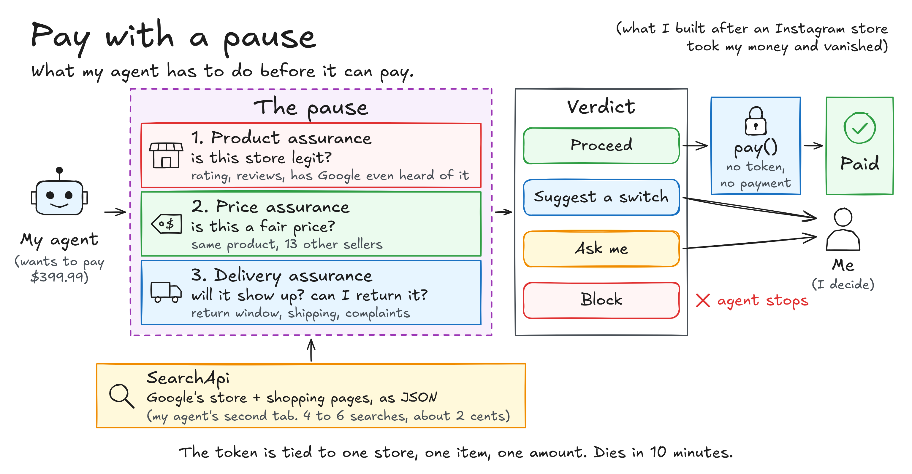

# Pay with a pause

A checkpoint an AI agent has to pass before it pays.



When a person buys something online, they do a quick check without thinking about it: is this store real, and is this a fair price? An agent with a card skips that step. This project puts it back, as code the agent can't talk its way around:

1. **Is the store trustworthy?** Rating, review count, return window, shipping, and whether Google has ever heard of the domain.
2. **Is there a better deal?** The same product at other sellers, with delivery included, and whether those sellers pass the same trust check.
3. **Decide.** Proceed, suggest a switch, ask the human, or block. Every verdict lists its reasons.

`pay()` refuses to run without a token from `pause()`. The token is tied to one store, one item and one amount, works once, and expires in ten minutes.

The data comes from [SearchApi](https://www.searchapi.io/?utm_source=dev&utm_medium=ambassador&utm_campaign=akshaychugh.xyz), which returns Google's store, shopping and product pages as JSON.

> SearchApi sponsored this project and gave me API credits. The code and the opinions in the rubric are mine. This is not an official SearchApi project.

## Try it

You need Python 3.10+ and a SearchApi key. [Sign up here](https://www.searchapi.io/?utm_source=dev&utm_medium=ambassador&utm_campaign=akshaychugh.xyz): the free tier has 100 requests, which is about 20 full pauses.

```bash
git clone https://github.com/akshaychugh-xyz/pause-and-pay
cd pause-and-pay
pip install -e .
export SEARCHAPI_API_KEY=your_key
```

The core has no dependencies outside the standard library.

```bash
pause check --url https://www.brandsmartusa.com \
  --item "Sony WH-1000XM5 Wireless Noise Canceling Headphones" --price 399.99
```

```text
PAUSE   brandsmartusa.com | Sony WH-1000XM5 Wireless Noise Canceling Headphones | 399.99 USD
VERDICT SUGGEST SWITCH

Why:
  - Same product is $100.00 (25%) cheaper at Best Buy: $299.99 incl. delivery. That store is
    rated 4.6/5 from 1,669 reviews, 15-day returns.

Also checked:
  - BrandsMart USA: rated 4.6/5 from 246 reviews, Top Quality Store.
  - Cheaper at FlexShopper ($244.94), but skipped: can't confirm it sells this item new.
  - Cheaper at eBay ($249.99), but skipped: marketplace listing; seller and condition can't be checked.
  - Cheaper at Beachcamera ($279.99), but skipped: listed as open box.
  - Cheaper at Reebelo USA ($288.99), but skipped: can't confirm it sells this item new.

Searches: 6 (google_about_this_store, google_shopping, google_product, google_product_offers,
          google_about_this_store, google_about_this_store)
```

Prices and ratings are live, so your output will differ.

## How it works

```text
agent wants to pay
        |
        v
   +---------+   trust check  -> google_about_this_store  (+ google_about_this_domain,
   |  pause  |                                              google, only for unknown stores)
   +---------+   deal check   -> google_shopping -> google_product + google_product_offers
        |
        v
     decide()  ->  proceed          token issued, pay() will run
                   suggest_switch   same product, cheaper, at a seller that passes the same check
                   ask_human        something is unknown or off
                   block            two independent bad signals
```

| File | What it does |
|---|---|
| `src/pause/trust.py` | `check_store()`: what Google knows about the store |
| `src/pause/deal.py` | `find_better_deal()`: the same product at other sellers |
| `src/pause/rubric.py` | `decide()`: plain if/else that turns the two reports into a verdict |
| `src/pause/judge.py` | optional: a model makes the judgment calls instead of the thresholds |
| `src/pause/gate.py` | `pause()`, the token, and a mock `pay()` that refuses without one |
| `src/pause/searchapi.py` | a 100-line SearchApi client |

A full pause is 4 to 6 searches. One search is one SearchApi credit.

### The rubric

These are opinions. They live in `Policy` in `src/pause/models.py`; change them, or [let a model make the calls](#let-a-model-make-the-judgment-calls).

| Signal | Result |
|---|---|
| Known store, under $50 | no pause at all |
| Known store, $50 to $100 | trust check only |
| New store, or $100 and up | trust and deal check |
| Store rating below 3.5 (50+ reviews) | ask the human |
| No store profile on Google | ask the human |
| No profile, and the domain uses the brand's name | block |
| No profile, and the price is 40%+ below usual | block |
| Price 25%+ below usual at any store | ask the human (often used or refurbished) |
| Return window under 14 days on $100+ | ask the human |
| Urgent, and the store ships slower than needed | ask the human |
| Same product 10%+ cheaper at a seller rated 4.0+ (100+ reviews) with a return policy | suggest a switch |
| Search failed | ask the human, never proceed |

Three things the rubric will not do:

- **Switch sellers on its own.** A cheaper seller is a suggestion for the human.
- **Treat missing data as a scam.** Unknown means ask.
- **Trust the cheapest offer.** Google's offer data has no "refurbished" field, so an alternative only counts if the seller also shows up when Google Shopping is filtered to new items.

## Let a model make the judgment calls

Fixed thresholds are easy to explain and easy to get wrong. "Rating below 3.5" treats a brand's own store with 13 reviews like a risk, and "10% cheaper" treats $3 off a cable like $300 off a laptop. With `--judge llm`, a model weighs the same evidence the way a person would, and your thresholds become a sentence:

```bash
pip install -e ".[llm]"
export ANTHROPIC_API_KEY=your_key

pause check --url https://www.bestbuy.com \
  --item "Sony WH-1000XM5 Wireless Noise Canceling Headphones" --price 299.99 \
  --judge llm \
  --preferences "I return things a lot, so I want at least 30 days. A saving under $20 isn't worth switching for."
```

The model is not trusted with everything. Code keeps a floor it cannot move:

| Decided by code, always | Decided by the model |
|---|---|
| The search failed: ask the human | Is this rating good enough, given how many reviews are behind it? |
| Google has no profile of the store: ask the human | Is this return window fine for this item and this price? |
| Unknown store that imitates a brand, or is absurdly cheap: block | Does slow shipping matter for this purchase? |
| Which cheaper sellers are even eligible (new, same product, store checked) | Is the saving worth switching for, and to which eligible seller? |
| The price of the alternative, and the token for `pay()` | The reasons shown to the human |

Three more guards:

- **The model never sees raw web text.** It gets numbers and short, cleaned names. Reviews, store descriptions and page content stay out, because a store that wants your money controls some of that text.
- **It can only pick a seller from the list the code gives it.** If it names anyone else, the verdict becomes "ask the human".
- **If the model call fails for any reason, the fixed thresholds decide.** The receipt records which judge decided and what the thresholds would have said.

The default model is `claude-opus-5-5` at low effort; set `PAUSE_JUDGE_MODEL` to change it. If a safety classifier declines a request, the call retries on Anthropic's recommended fallback model. One model call is added per judged pause. Hard stops and skipped purchases never call it.

In Python it is one field: `pause(intent, policy=Policy(judge="llm", preferences="..."))`. For the MCP server, set `PAUSE_JUDGE=llm`. To compare the two judges on the test cases, run `pause scorecard cases/cases.json --judge llm`; each row shows what the thresholds would have said.

## Use it with your personal agent

**An agent you run yourself** (it has a shell, or you can add MCP servers to it): point it at this repo. [AGENTS.md](AGENTS.md) tells it how to install the pause, when to call it and what to do with each verdict. This is the real lock: the agent only gets a `pay` tool that refuses without a token.

**A hosted agent you can't install code into:** give it the link to [PRINCIPLES.md](PRINCIPLES.md) and tell it to follow those rules before it pays. It runs the same three checks with its own web search. Be clear with yourself about what this is: a request the agent chooses to follow, not a lock.

**Your own payment function:** wrap it, and give the agent only the wrapped one.

```python
from pause import require_pause

@require_pause
def charge_card(merchant_url, item, price, currency="USD"):
    ...  # Stripe, a wallet, an agent checkout protocol

charge_card(url, item, price, pause_token=receipt.token)
```

If the agent calls your payment function itself, `pause_first` runs the pause inside the call, so there is no token to pass around:

```python
from pause import pause_first

@pause_first
def charge_card(merchant_url, item, price, currency="USD"):
    ...

charge_card(url, item, price)   # pays, or raises PauseRequired with the reasons and the receipt id
```

## Use it in your code

```python
from pause import PurchaseIntent, pause, pay

intent = PurchaseIntent("https://www.bestbuy.com", "Sony WH-1000XM5 headphones", 299.99)
receipt = pause(intent)

if receipt.verdict.decision == "proceed":
    pay(intent.merchant_url, intent.item, intent.price, pause_token=receipt.token)
else:
    print(receipt.verdict.reasons)   # show the human, then `pause approve <receipt id>`
```

`pay()` is a mock, so no money moves. For a real payment, wrap your own function with `require_pause` as shown above, or see the x402 section below for one that is already wired up.

Every pause writes a receipt to `~/.pause/receipts/`: what was checked, each SearchApi search id, the offers it saw, and why it decided what it did.

### As an MCP server

```bash
pip install -e ".[mcp]"
claude mcp add pause -e SEARCHAPI_API_KEY=your_key -- pause-mcp
```

The agent gets two tools, `pause_before_pay` and `pay`. There is no approve tool on purpose. When the verdict is not "proceed", the human runs `pause approve <receipt id>` in a terminal and hands the token to the agent.

## Use it with x402

[x402](https://www.x402.org) puts the payment into HTTP. The seller answers `402 Payment Required` with what it wants paid, and the client signs a stablecoin payment and retries. The official Python client runs hooks between those two steps. `add_pause()` goes there, so the client cannot sign until the pause says proceed or you approve.

```python
from x402 import x402Client
from x402.http.clients import x402HttpxClient
from x402.mechanisms.evm.exact import register_exact_evm_client
from pause.x402_hook import add_pause

client = register_exact_evm_client(x402Client(), signer)

async with x402HttpxClient(add_pause(client)) as http:
    response = await http.get("https://store.example/buy/123")
```

Give your agent `http`. Keep `client` and the signer away from it.

You can watch it work against the x402 project's public test endpoint. It needs no funds, because the script makes a throwaway key:

```bash
pip install -e ".[x402]"
python examples/x402_demo.py
```

```
1. The agent asks for https://x402.org/protected. The seller answers 402 and the pause runs.
   Nothing was signed. The agent gets:
   Failed to handle payment: Payment aborted: Pause said ASK THE HUMAN (receipt 645d47f6d1ed):
   Google has no store profile for x402.org (domain history: x402.org was first indexed by
   Google in March 2025). To pay here anyway, your human runs `pause approve 645d47f6d1ed`
   and you retry within 10 minutes.

2. You read the receipt and decide it's fine: pause approve 645d47f6d1ed
3. The agent retries. This time the client signs and sends the payment.
   Seller answered 402: invalid_exact_evm_insufficient_balance
```

That last line is the seller turning down a signed payment from an empty wallet. That is as far as I have tested it. I have not run it with a funded wallet.

What to know before you rely on it:

- The pause checks the site the request went to. The 402 also names a site, but the seller writes the 402, so that name is ignored.
- An approval covers one payment of that exact amount to that site. The next request pauses again.
- Most of what is sold over x402 today is API calls and data, and Google has no store profile for an API host. So the first payment to a new host comes back as "ask me". List the hosts you already use in `Policy(known_merchants=...)`, and payments under $50 to them skip the pause.
- The price comparison is off for the same reason. Pass `compare_prices=True` when the client buys products.
- Amounts are read as dollars only for the dollar stablecoins the x402 SDK lists. Anything else is refused.
- The x402 client has its own cap of $1 a payment, and the pause does not raise it. Change it with `client.set_spend_controls(...)` if you want bigger payments to reach the pause.

Other rails need the same thing: find the call that commits the money and wrap it with `pause_first` (or `require_pause`). With a card, that is the charge. With an agent checkout protocol, it is the call that completes the checkout. x402 is the only rail I have wired up and tested end to end.

## Scorecard

`cases/cases.json` holds purchase scenarios with the verdict a careful person would expect. Run them against live data:

```bash
pause scorecard cases/cases.json
```

The last run is in [SCORECARD.md](SCORECARD.md), dated. The risky stores in it are made-up `.example` domains. I'm not going to label a real store as a scam in a test file.

The cases that depend on a price are pinned to the prices on the day I wrote them. A week later the same headphones had dropped in price and Google was showing a different listing for them, and four "expected" verdicts had changed. The store checks and hard stops did not move. Treat the expected column as a record of one day, not a test that should stay green.

Offline tests use invented stores and need no key:

```bash
pip install -e ".[dev]" && pytest
```

## Limits

- Search results are a signal, not proof. A new honest store looks the same as a new dishonest one: unknown.
- Matching the agent's item to a Google product listing is a guess from the title, and it is the least stable part: Google can return a different listing for the same query an hour later. The receipt says which listing was matched and how confident it is.
- Offer data doesn't say if an item is used, refurbished or leased. The rubric is conservative here and will miss some real deals.
- Coupons and equivalent products are not checked.
- Thresholds are in dollars. For other currencies, scale them with `Policy().scaled(85)`.
- A token is used up when the payment starts. If the payment then fails, the agent has to pause again.

## License

MIT
